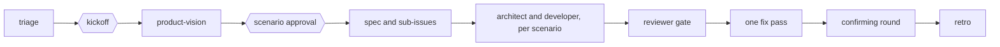

# How the pipeline works

The pipeline is the default path for new or changed behavior in a repo that has `.claude/pipeline.json`. The plugin's SessionStart hook loads the workflow rules into every session there, so a request for behavior that does not exist yet enters the pipeline without a command. `/pipeline:intent-and-goal` forces it; it is the scoping procedure, not the trigger.

## Three lanes

The `triage` agent scopes each request against the code and ends with a lane. The lane sets how much process the work pays.

| Lane | Covers | Process |
|---|---|---|
| Full | New user-visible behavior (a feature, screen or flow), new API surface (an RPC, endpoint, message, field or event), or a change to an existing contract | The whole pipeline |
| Light | A behavior change confined to one package, with no new user-visible surface | Triage, kickoff, a short spec with no product-spec ruling, approval, build, gate |
| Direct | A named bug with a known fix, a refactor or cleanup with no behavior change, config, dependencies, CI, tooling, docs, the pipeline's own config | The work itself, with no spec, no pauses and no gate |

A question about how existing behavior works is not a lane: the session answers it. Work already covered by a spec under `docs/specs/` resumes at its first unbuilt scenario.

## The Full lane, in order

`product-vision` writes the surface-and-copy ruling into `docs/product/<area>.md`. The feature spec is `docs/specs/<slug>.md`, with one sub-issue per scenario. Per scenario, the `architect` writes a checklist (for large scenarios only) and the `developer` implements it. The gate runs a correctness reviewer and a test reviewer for each surface the diff touches. The `refuter` tries to disprove each MAJOR finding before it costs a fix pass. The Light lane runs the same order without `product-vision`.

## Two pauses

The pipeline stops for the user twice, and only twice:

- **Kickoff**, after triage and before any product spec or scenario: confirm what was understood, answer the open questions, and choose to run here or unattended.
- **Spec approval**, before the feature spec is written and its issues opened.

Everything after approval continues without asking. Pass conditions and the feature budget are defaults in `.claude/pipeline.json`, not questions. `pipeline.py next` refuses a spec that lacks the kickoff's answers or its `**Approved**:` line.

## Nothing ships untested

Each scenario starts with one acceptance test that fails before any production code exists. Inside it, bug fixes, security guards and atomic store adapters are strictly test-first; everything else is built in small code-first batches of code, tests and refactor.

## Single-session mode

A repo whose `pipeline.json` sets `"mode": "single-session"` gets the lanes and the testing rule at session start, but not the implicit trigger, the two pauses or the agent roster. The work is done in the session itself. `runner.py` and `pipeline.py next` refuse to run there, and `/pipeline:retro` writes a Full-lane feature's retro from its merged PRs.

The long form of these rules is the plugin's [workflow brief](https://github.com/koblas/throughline/blob/main/plugins/pipeline/briefs/workflow.md) and [orchestration brief](https://github.com/koblas/throughline/blob/main/plugins/pipeline/briefs/orchestration.md).
