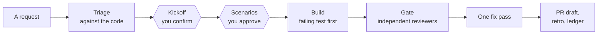

<div class="landing" markdown>

<div class="landing-hero" markdown>

<p class="landing-kicker">pipeline, a Claude Code plugin</p>

# An agent writes the diff in minutes. This is everything around the diff. {: .landing-title }

<p class="landing-lead">A coding agent turns one sentence into working-looking code before anyone has agreed what was asked for, proved it with a test, or had someone else read it. <strong>pipeline</strong> puts those steps back: scope confirmed before code, a test that fails first, an independent review, and a cost ledger. It is the default path in the repo, not a command to remember.</p>

[Your first feature](tutorials/first-feature.md){ .md-button .md-button--primary }
[Why it exists](concepts/why.md){ .md-button }

<p class="landing-note">Open source, MIT. Installs from the <code>throughline</code> marketplace. Go and TypeScript are built in; any other language plugs in through an adapter.</p>

</div>

<div class="landing-stats" markdown>

<div class="landing-stat" markdown>
<span class="landing-stat-n">2</span>
<span class="landing-stat-l">pauses for a person: the kickoff and spec approval. Everything after runs on its own.</span>
</div>
<div class="landing-stat" markdown>
<span class="landing-stat-n">1</span>
<span class="landing-stat-l">acceptance test per scenario, seen failing before any production code exists</span>
</div>
<div class="landing-stat" markdown>
<span class="landing-stat-n">1</span>
<span class="landing-stat-l">fix pass after the reviewer gate, then one confirming round. There is no third.</span>
</div>
<div class="landing-stat" markdown>
<span class="landing-stat-n">3</span>
<span class="landing-stat-l">lanes, so a typo fix does not pay for the process a new API does</span>
</div>

</div>

## What goes wrong without it {: .landing-h2 }

<p class="landing-sub">Four ways an unattended agent ships the wrong thing, and what the pipeline does about each.</p>

<div class="grid cards landing-two" markdown>

-   :material-map-marker-question: **It builds what it guessed**

    ---

    An offhand request becomes a finished diff. The pipeline triages the request against the code first, then stops at a three-line **kickoff**: what it understood, what it could not answer, how to run. A wrong reading costs nothing to correct there.

-   :material-test-tube-off: **Its tests prove nothing**

    ---

    Tests written after the code pass by construction. Each scenario starts with one acceptance test that fails at its assertion, for the expected reason. A hook then locks that test, so the run that builds the code cannot also decide what passing means.

-   :material-account-multiple-check: **It reviews its own work**

    ---

    The agent that wrote the code says the code is fine. At the gate, separate reviewer agents read the diff: one for correctness and one for tests, per surface the change touches. A mutation sample breaks changed lines and names the ones no test notices.

-   :material-cash-clock: **It never stops, and nobody knows the cost**

    ---

    Fix, re-review, fix again. The pipeline allows one fix pass and one confirming round, then hands back to a person. Every run is tagged and priced into the feature's ledger, against a budget set in the repo.

</div>

## One path from request to merged PR {: .landing-h2 }



<p class="landing-caption">The two hexagons are the only places it waits for you. <a href="concepts/how-the-pipeline-works/">How the pipeline works.</a></p>

## Process sized to the change {: .landing-h2 }

<p class="landing-sub">Triage ends with a lane. The lane sets how much process the work pays.</p>

<div class="grid cards" markdown>

-   **Full**

    ---

    New user-visible behavior, new API surface, or a changed contract. Product ruling, scenarios, spec, build, gate, retro.

-   **Light**

    ---

    A behavior change inside one package with no new surface. A short spec, the same build and gate, no product ruling.

-   **Direct**

    ---

    A known fix, a refactor, config, CI, docs. The work itself: no spec, no pauses, no gate.

</div>

## Scripts hold the line, not prompts {: .landing-h2 }

<p class="landing-sub">A rule an agent is asked to follow gets skipped under pressure. The rules that matter are programs.</p>

<div class="grid cards landing-two" markdown>

-   :material-lock: **The acceptance-test lock**

    ---

    A `PreToolUse` hook refuses an edit that changes a scenario's acceptance test while a build run is pending.

-   :material-file-check: **`spec-check`**

    ---

    Refuses a spec without the kickoff's answers or its approval record, and a scenario whose named test does not exist or does not pass.

-   :material-ray-start-arrow: **The conductor**

    ---

    `pipeline.py next` prints the one next step and keeps its cursor on disk. The session does what it prints; it does not improvise the order.

-   :material-robot: **The runner**

    ---

    `runner.py` drives the same loop with no chat session, inside its own sandbox profile, and stops with a reason and an exit code where a person must decide.

</div>

<div class="landing-close" markdown>

## Try it on a repo. {: .landing-h2 }

```
/plugin marketplace add koblas/throughline
/plugin install pipeline@throughline
```

[Your first feature](tutorials/first-feature.md){ .md-button .md-button--primary }
[Examples](examples/index.md){ .md-button }
[Reference](reference/index.md){ .md-button }

</div>

</div>
